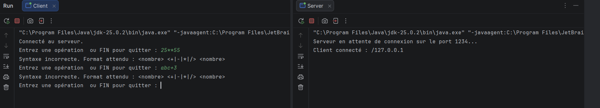
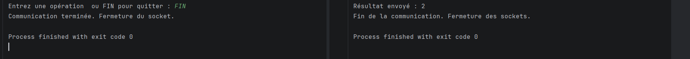
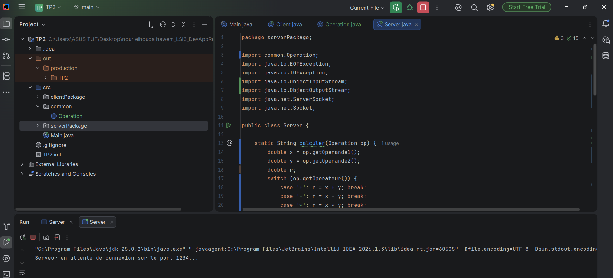
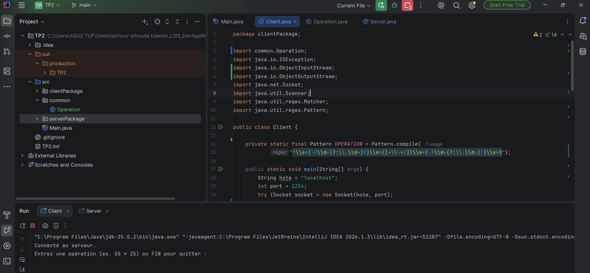
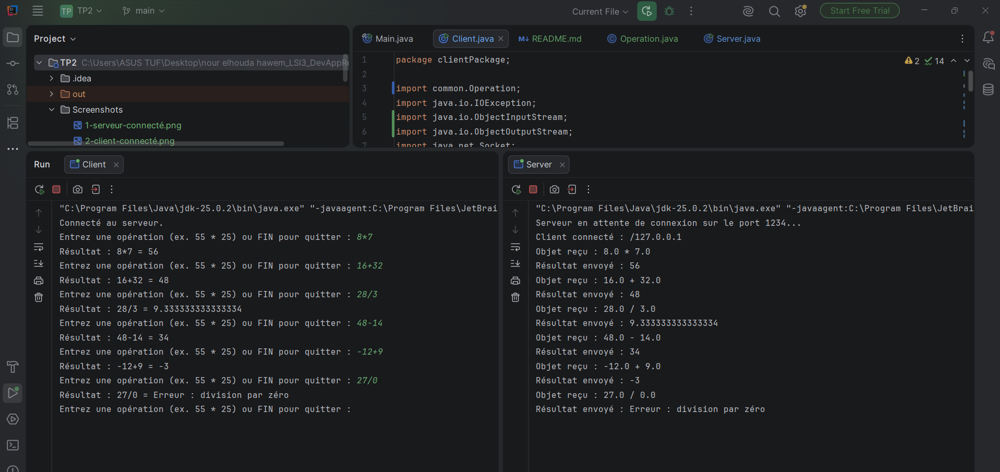
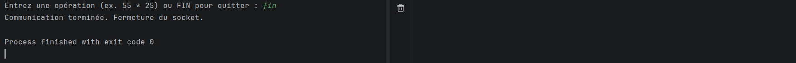

# TP 2 : Les sockets en mode connecté TCP : E/R de CC & objets
## Activité 2-1 : Échange de CC entre Client/Serveur via les Sockets TCP 
Le client envoie une opération arithmétique complète au serveur sous forme de chaîne de caractères. Le serveur effectue le calcul et renvoie le résultat au client.
## 1.Exécution du serveur

 ## 2.Connexion du client

## 3. Calculatrice avec échange de chaînes de caractères
Le client saisit une opération arithmétique, par exemple 34 * 55, puis l’envoie au serveur sous forme de chaîne de caractères. Le serveur analyse l’opération, effectue le calcul et renvoie le résultat au client.
## 3.1.Tests des opérations arithmétiques
Cette capture permet de vérifier le fonctionnement des quatre opérations arithmétiques : l’addition, la soustraction, la multiplication et la division. Le client envoie les opérations au serveur, qui effectue les calculs et renvoie les résultats.

## 3.2.Validation des erreurs
Le client vérifie la syntaxe avant d’envoyer l’opération au serveur. Les opérations incorrectes, comme 25 ** 55 ou abc + 3, sont rejetées.

## 3.3.Arrêt de l'application
Le client quitte l’application après les tests et la connexion avec le serveur est fermée.

## Activité 2-2 : Échange des objets entre Client/Serveur via les Sockets TCP 
## 1.Exécution du serveur

## 2.Connexion du client

## 3.Création et envoi de l'objet
Le client crée un objet qui implémente l’interface Serializable. Cet objet contient les deux opérandes et l’opérateur de l’opération arithmétique.
## 3.1.Tests des opérations arithmétiques
Cette capture présente les tests de l’addition, de la soustraction, de la multiplication et de la division à travers l’échange d’objets sérialisables entre le client et le serveur.

## 3.2.Arrêt de l'application

 ## Conclusion

Ces deux activités permettent de comprendre l’échange de données entre un client et un serveur à l’aide des sockets TCP en Java.

L’activité 2-1 utilise des chaînes de caractères pour transmettre les opérations arithmétiques.

L’activité 2-2 utilise des objets Java sérialisables contenant les opérandes et l’opérateur.

Dans les deux activités, le serveur effectue le calcul et renvoie le résultat au client.